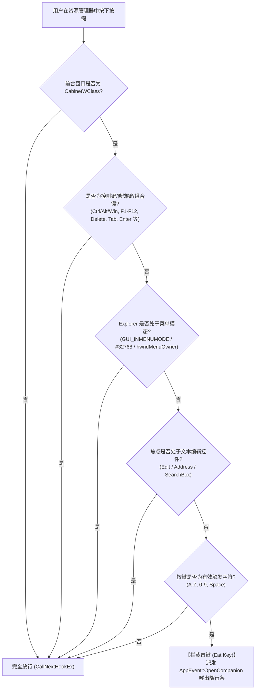
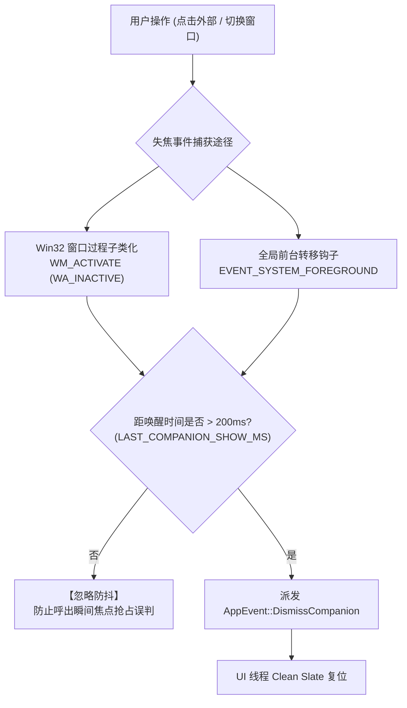

# ZenSearch 资源管理器随行增强设计规范 (Explorer Companion)

> **文档版本**：v2.0  
> **技术栈选型**：Rust 2021 + Slint UI + Win32 COM (`IShellWindows`) + Win32 Hooks (`WH_KEYBOARD_LL`, `SetWinEventHook`)  
> **模块定位**：深度集成 Windows 文件资源管理器（File Explorer），提供直接键入即搜（Type-to-Search）、当前浏览目录范围限定搜索（Scoped Search）、底部锚定倒置吸附以及候选视口光标跟随能力的伴随式检索浮窗。  
> **关联架构**：[architecture.md](file:///d:/ZenSearch/docs/architecture.md)

---

## 一、 系统定位与核心能力

**ZenSearch 资源管理器随行伴侣 (Explorer Companion)** 为 Windows 原生资源管理器提供零侵入、毫秒级的轻量随行搜索体验：

1. **直接键入即搜 (Type-to-Search)**：用户聚焦在资源管理器文件列表时，直接敲击键盘输入字符，自动唤起随行搜索条并捕获该首字符；
2. **目录范围限定 (Scoped Search)**：自动提取当前 Explorer 浏览的物理路径，组装 `path:"<CurrentDir>" <keywords>` 毫秒级返回子集匹配项；
3. **右下角吸附与倒置布局 (Bottom-Pinned Docking)**：浮窗吸附于当前 Explorer 内部右下角；输入栏底端固定，结果列表向上延伸，保证输入焦点屏幕绝对位置恒定；
4. **原生菜单与单键加速键穿透 (Context Menu Pass-through)**：实时感知右键上下文菜单与系统菜单模态状态，放行单键快捷键（如 `r` 属性、`d` 删除、`c` 复制、`x` 剪切等）及原生文本编辑事件；
5. **视口光标滚动跟随 (Scroll-Follow-Selection)**：方向键导航时光标与视口平滑联动，超出可视区域自动计算最小滚动偏移，首末项边界驻留不回绕；
6. **失焦无状态隐去 (Blur-to-Dismiss Clean Slate)**：随行条失焦或前台转移时即刻隐去，并完整重置输入、滚动偏移及结果模型。

---

## 二、 按键拦截与智能穿透机制

### 1. 拦截判定时序模型

随行模块通过低级键盘钩子（`WH_KEYBOARD_LL`）监控击键事件，执行层次化过滤：



### 2. 规则定义

* **完全放行规则**：
  * **控制与功能键**：`Ctrl` / `Alt` / `Win` 组合键、`Enter`、`Escape`、`Tab`、`Delete`、`Backspace`、`F1`~`F12`、方向键、`CapsLock` 等；
  * **模态菜单态**：检测到右键上下文菜单、窗口系统菜单或下拉菜单激活时，放行所有按键（保障单键加速键盲操体验）；
  * **输入控件态**：焦点处于原生地址栏（`Address Band Root`）、搜索框或重命名编辑框（`Edit`）时，放行所有击键。
* **拦截与激活规则**：
  * 当焦点位于资源管理器展示区且未处于菜单与编辑状态时，捕获首个有效字符（`a-z`、`0-9`、空格）；
  * 吞掉（Eat）该击键事件（返回 `LRESULT(1)`），通过通道发送 `AppEvent::OpenCompanion`，并将首字符注入随行输入框。

### 3. 模态菜单与编辑状态感知实现

利用 Win32 `GetGUIThreadInfo` 读取资源管理器 UI 线程内部状态：

```rust
const GUI_INMENUMODE: u32 = 0x00000004;
const GUI_SYSTEMMENUMODE: u32 = 0x00000008;
const GUI_POPUPMENUMODE: u32 = 0x00000010;

pub fn is_explorer_editing_or_menu_active(exp_hwnd: HWND) -> bool {
    unsafe {
        use windows::Win32::UI::WindowsAndMessaging::{GetClassNameW, GetGUIThreadInfo, GUITHREADINFO};
        let mut gui = GUITHREADINFO {
            cbSize: std::mem::size_of::<GUITHREADINFO>() as u32,
            ..Default::default()
        };
        let thread_id = windows::Win32::UI::WindowsAndMessaging::GetWindowThreadProcessId(exp_hwnd, None);
        if GetGUIThreadInfo(thread_id, &mut gui).is_ok() {
            // 1. 检查菜单循环及弹出菜单状态
            let in_menu = (gui.flags.0 & (GUI_INMENUMODE | GUI_POPUPMENUMODE | GUI_SYSTEMMENUMODE)) != 0;
            let has_menu_owner = gui.hwndMenuOwner.0 != std::ptr::null_mut();
            if in_menu || has_menu_owner {
                return true;
            }

            // 检查活动窗口是否为标准上下文菜单窗口 (#32768)
            if gui.hwndActive.0 != std::ptr::null_mut() {
                let mut class_buf = [0u16; 32];
                let len = GetClassNameW(gui.hwndActive, &mut class_buf);
                let class_str = String::from_utf16_lossy(&class_buf[..len as usize]);
                if class_str == "#32768" {
                    return true;
                }
            }

            // 2. 检查焦点是否在重命名输入框、地址栏或原生搜索栏
            if gui.hwndFocus.0 != std::ptr::null_mut() {
                let mut class_buf = [0u16; 64];
                let len = GetClassNameW(gui.hwndFocus, &mut class_buf);
                let class_str = String::from_utf16_lossy(&class_buf[..len as usize]);
                if class_str.contains("Edit") || class_str.contains("Address") || class_str.contains("SearchBox") {
                    return true;
                }
            }
        }
    }
    false
}
```

---

## 三、 目录解析与限定检索规范 (Scoped Search)

### 1. 物理路径提取流程 (`src/core/explorer.rs`)

通过 `IShellWindows` 枚举活动资源管理器窗口，并根据层级归属匹配目标窗口路径：

```rust
pub fn get_explorer_path(target_hwnd: HWND) -> Option<String> {
    let _guard = ComGuard::new();
    unsafe {
        let shell_windows: IShellWindows =
            CoCreateInstance(&ShellWindows, None, CLSCTX_LOCAL_SERVER).ok()?;
        let count = shell_windows.Count().ok()?;

        for i in 0..count {
            let var_idx = VARIANT::from(i);
            if let Ok(dispatch) = shell_windows.Item(&var_idx) {
                if let Ok(web_browser) = dispatch.cast::<IWebBrowser2>() {
                    if let Ok(hwnd_val) = web_browser.HWND() {
                        let win_hwnd = HWND(hwnd_val.0 as _);
                        if win_hwnd == target_hwnd || is_parent_or_equal(win_hwnd, target_hwnd) {
                            if let Ok(bstr_url) = web_browser.LocationURL() {
                                if let Some(path) = file_url_to_path(&bstr_url.to_string()) {
                                    if PathBuf::from(&path).exists() {
                                        return Some(path);
                                    }
                                }
                            }
                        }
                    }
                }
            }
        }
    }
    None
}
```

### 2. 查询参数装配与引擎调度

提取当前目录物理路径后，拼接 Everything 检索语法并执行毫秒级检索：

```rust
let search_query = format!("path:\"{}\" {}", current_dir, kw);
let results = crate::core::everything::execute_ranked_query(
    &search_query,
    10,
    crate::core::ranking::SearchContext::Companion,
);
```

### 3. 候选项独立定位交互规范 (`Ctrl + O` 与鼠标右键)

在候选列表中按 `Ctrl + O` 或鼠标右键单击条目时调用 `open_in_new_explorer_and_select(&item.path)`：
* 使用 `/n, /select,"<Path>"` 启动独立资源管理器进程，避免复用现有窗口或标签页；
* 盘符根目录（如 `C:\`）直接以 `/n,"C:\"` 打开。

```rust
pub fn build_explorer_select_args(path: &str) -> Option<String> {
    let raw = path.trim();
    if raw.is_empty() {
        return None;
    }
    let normalized = raw.replace('/', "\\");
    let trimmed = normalized.trim_end_matches('\\');
    if trimmed.len() <= 2 && trimmed.ends_with(':') {
        return Some(format!("/n,\"{}:\\\"", &trimmed[0..1]));
    }
    Some(format!("/n, /select,\"{}\"", trimmed))
}
```

---

## 四、 几何吸附与倒置布局规范 (Docking & Layout)

### 1. 倒置结构设计 (Top-Anchored Results & Bottom-Pinned Input)

随行条采用输入栏居底、结果列表向上延伸的倒置布局：

```
+─────────────────────────────────────────────────────────────+
| [Slint 随行浮窗 ui/companion.slint]                          |
|                                                             |
| ┌─────────────────────────────────────────────────────────┐ │
| │ 搜索结果列表 (ListView)                                  │ │ ──> 仅在 is_expanded 为 true 时渲染
| │ 向上生长延伸 (最大 280dp，自适应条数)                    │ │     位于输入栏上方
| │ • 结果项 1 (系统图标 + 文件名 + 完整路径)                │ │
| │ • 结果项 2 (系统图标 + 文件名 + 完整路径)                │ │
| └─────────────────────────────────────────────────────────┘ │
| ┌─────────────────────────────────────────────────────────┐ │
| │ 📁 [随行搜索当前目录 (Esc 关闭)...]                      │ │ ──> 输入栏固定在浮窗最底端
| └─────────────────────────────────────────────────────────┘ │
+─────────────────────────────────────────────────────────────+
```

* **逻辑尺寸规格**：
  * 输入栏高度：$H_{input} = 46\text{dp}$；
  * 单条结果项高度：$H_{item} = 44\text{dp}$（内部视图项高 $42\text{px}$）；
  * 列表区域高度：$H_{list} = \text{if expanded } \{ \min(280.0, \text{count} \times 44.0) + 8.0 \} \text{ else } 0.0$；
  * 浮窗总逻辑高度：$H_{companion} = H_{input} + H_{list}$；
  * 浮窗逻辑宽度：$W_{companion} = \text{clamp}(400, W_{exp} \times 0.52, 640)$。

### 2. 底部基准锚定与防溢出算法

浮窗底端紧贴 Explorer 内部右下角，通过保持输入框物理屏幕位置恒定避免视觉抖动：

$$Y_{target} = Y_{exp.bottom} - H_{companion} - \text{margin}$$

$$Y_{input\_screen} = Y_{target} + H_{list} = Y_{exp.bottom} - H_{input} - \text{margin}$$

```rust
pub fn calculate_companion_dock_geometry(
    exp_rect: RECT,
    is_expanded: bool,
    result_count: usize,
) -> ScreenMetrics {
    let (h_monitor, work) = get_monitor_and_work_area_for_rect(&exp_rect);
    let scale = get_monitor_scale_factor(h_monitor);

    let exp_w = exp_rect.right - exp_rect.left;
    let exp_w_logical = exp_w as f32 / scale;
    let comp_w_logical = (exp_w_logical * 0.52).clamp(400.0, 640.0);

    let base_height_logical: f32 = 46.0;
    let item_height_logical: f32 = 44.0;
    let list_height_logical: f32 = if is_expanded {
        ((result_count as f32) * item_height_logical).min(280.0) + 8.0
    } else {
        0.0
    };
    let comp_h_logical = base_height_logical + list_height_logical;

    let comp_w = (comp_w_logical * scale).round() as i32;
    let comp_h = (comp_h_logical * scale).round() as i32;
    let margin = (12.0 * scale).round() as i32;

    let target_x = exp_rect.right - comp_w - margin;
    let target_y = exp_rect.bottom - comp_h - margin;

    // 工作区边界安全裁剪 (Boundary Clamping)
    let safe_x = target_x.clamp(
        work.left + margin,
        (work.right - comp_w - margin).max(work.left),
    );
    let safe_y = target_y.clamp(
        work.top + margin,
        (work.bottom - comp_h - margin).max(work.top),
    );

    ScreenMetrics { x: safe_x, y: safe_y, width: comp_w, height: comp_h }
}
```

### 3. 宿主窗口联动感知

注册 WinEvent 钩子：
* `EVENT_OBJECT_LOCATIONCHANGE`：当 Explorer 被移动或缩放尺寸时，实时重算并更新浮窗坐标，保持贴边；
* `EVENT_SYSTEM_FOREGROUND`：当用户离开 Explorer 时驱动失焦隐去。

---

## 五、 候选列表键盘导航与视口跟随 (Scroll-Follow-Selection)

### 1. 视口绑定与导航约束

* **双向属性绑定**：在 `ui/companion.slint` 声明顶层属性 `in-out property <length> scroll_y: 0px;`，与内部 `ListView` 的 `content-y` 双向绑定；
* **边界驻留策略**：光标处于首项按 `UpArrow` 或处于末项按 `DownArrow` 时就地驻留，不循环跳跃。

### 2. 最小视口滚动算法 (`ensure_selected_visible`)

每次光标索引更新后调用该算法，确保当前选中项始终落在可视区域内：

```slint
public function ensure_selected_visible() {
    let view_h = min(280px, root.result_items.length * 44px);
    let item_top = root.selected_index * 42px;
    let item_bottom = item_top + 42px;

    if (item_top < -root.scroll_y) {
        root.scroll_y = -item_top;
    } else if (item_bottom > -root.scroll_y + view_h) {
        root.scroll_y = view_h - item_bottom;
    }
}
```

* 视口可视高度：$H_{view} = \min(280\text{px}, N \times 44\text{px})$；
* 选中项纵向跨度：$[Y_{top}, Y_{bottom}] = [\text{idx} \times 42\text{px}, (\text{idx} + 1) \times 42\text{px}]$；
* **上方越界校正**：$Y_{top} < -\text{scroll\_y} \implies \text{scroll\_y} = -Y_{top}$；
* **下方越界校正**：$Y_{bottom} > -\text{scroll\_y} + H_{view} \implies \text{scroll\_y} = H_{view} - Y_{bottom}$。

### 3. 视觉展现规范与图标缓存

* 列表项高 $42\text{px}$，内嵌 $16\times 16\text{px}$ 系统原生关联图标（置于 $22\text{px}$ 衬底中）；
* 结果项直接复用 `icon_provider` 单例缓存，检索当前目录结果时零额外 I/O 开销；
* 视觉层级与全局主搜索浮窗（Launcher）保持完全对齐。

---

## 六、 生命周期管理与失焦隐去机制 (Blur-to-Dismiss)

### 1. 失焦感知管道



### 2. 唤醒保护时间窗 (200ms Grace Period)

随行条唤起时通过 `record_companion_show_time()` 记录时间戳。在唤起后 200ms 内收到的失焦消息均被滤除，避免窗口焦点初始化移交阶段产生误隐去。

### 3. 无状态清空管线 (Clean Slate)

执行隐去时必须调用 `reset_state()`，彻底重置所有运行时状态：

```slint
public function reset_state() {
    root.search_text = "";
    root.is_expanded = false;
    root.selected_index = 0;
    root.scroll_y = 0px;
    comp_input.text = "";
    comp_input.focus();
}
```

1. 调用 `ui.hide()` 隐藏随行窗口；
2. 清空搜索文本输入，折叠结果列表 (`is_expanded = false`)；
3. 将选中索引复位为 0，视口滚动偏移归零 (`scroll_y = 0px`)；
4. 解绑当前关联的 Explorer 窗口句柄缓存，确保下次呼出时处于完全初始化的纯净状态。
